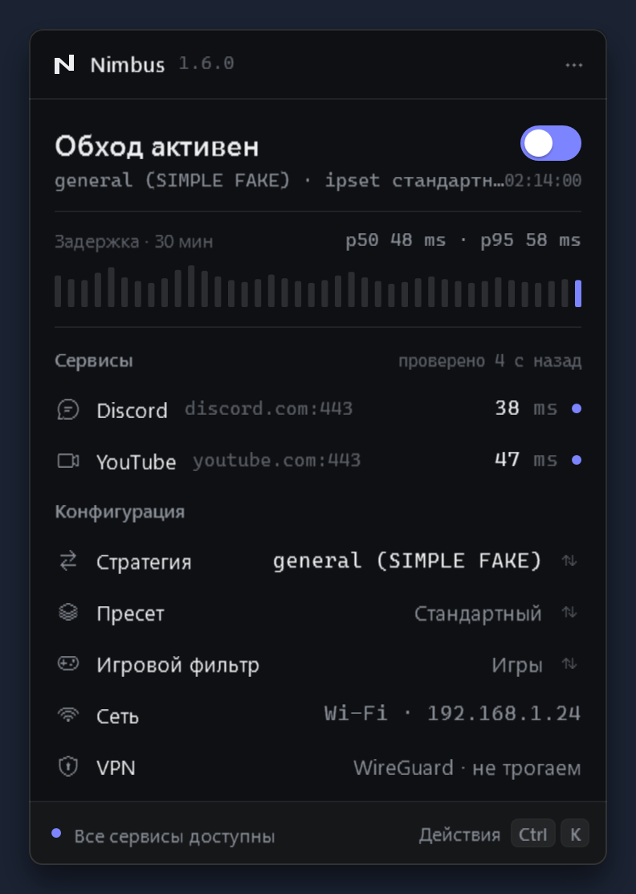
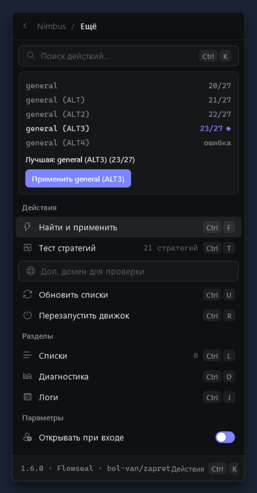
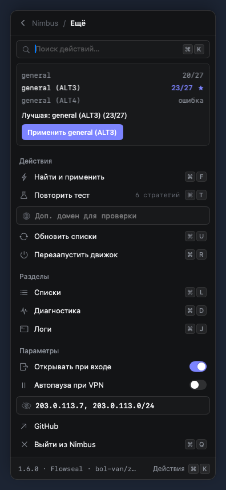

# Nimbus

Приложение для строки меню macOS и области уведомлений Windows. Запускает zapret, чтобы открывались Discord и YouTube. Основано на [Flowseal/zapret-mac-discord-youtube](https://github.com/Flowseal/zapret-mac-discord-youtube). Движок: [bol-van/zapret](https://github.com/bol-van/zapret).

<table>
  <tr>
    <th>Windows</th>
    <th>macOS</th>
  </tr>
  <tr>
    <td></td>
    <td></td>
  </tr>
  <tr>
    <td></td>
    <td></td>
  </tr>
</table>

<details>
<summary>Другие темы</summary>

| Windows | macOS |
| --- | --- |
|  |  |
|  |  |

</details>

Скриншоты сняты в CI из самого приложения, данные на них примерные (workflow `Screenshots` и `Build Windows x64`).

## Установка

### macOS

- macOS 14 или новее, Intel или Apple Silicon.
- При первом запуске понадобятся права администратора: устанавливается системный сервис.
- Выключите Cloudflare WARP: он перехватывает все соединения. Обычные VPN (OpenVPN, WireGuard и подобные) можно оставить.
- DNS должен быть не от провайдера, например `1.1.1.1` или `8.8.8.8`.

1. Скачайте `Nimbus-macOS-universal.zip` из [релизов](https://github.com/relocpe/Nimbus/releases).
2. Распакуйте архив и переместите `Nimbus.app` в папку «Программы».
3. Приложение подписано ad-hoc. При первом запуске откройте его через ПКМ → «Открыть» или снимите карантин:

   ```bash
   xattr -dr com.apple.quarantine /Applications/Nimbus.app
   ```

4. Нажмите на значок в строке меню, выберите стратегию и включите переключатель «Включить обход». macOS запросит пароль администратора.

Если вы обновляетесь с версии 1.4.0 или старше на macOS 27, одно обновление нужно поставить вручную: из-за бага `lipo -verify_arch` встроенный установщик старой копии не принимает универсальный бинарник. Распакуйте `Nimbus-macOS-universal.zip` и перетащите `Nimbus.app` в «Программы». Следующие обновления из меню снова встанут сами.

### Windows

- Windows 10 или 11, 64-бит.
- Права администратора: WinDivert загружает сетевой драйвер.
- Выключите Cloudflare WARP, GoodbyeDPI и другие сборки zapret. Обычные VPN можно оставить.
- DNS должен быть не от провайдера, например `1.1.1.1` или `8.8.8.8`.

1. Скачайте `Nimbus-Windows-x64.exe` из [релизов](https://github.com/relocpe/Nimbus/releases). Это один файл, установка не нужна: внутри уже есть .NET 8. Положите его в постоянную папку, например `C:\Program Files\Nimbus` или `C:\Users\<имя>\Apps`, и не удаляйте оттуда: на этот путь ссылаются автозапуск и обновления. Если .NET 8 Desktop Runtime уже установлен, можно взять более лёгкий `Nimbus-Windows-x64-lite.exe`.
2. Запустите файл и подтвердите запрос UAC. Если SmartScreen пишет «Система Windows защитила ваш компьютер», нажмите «Подробнее» → «Выполнить в любом случае»: файл не подписан сертификатом.
3. Откроется панель Nimbus. Выберите стратегию и включите переключатель «Включить обход». Потом панель открывается по клику на облако в области уведомлений; если значка не видно, он может быть спрятан под стрелкой `^`.

Windows Defender и другие антивирусы часто помечают WinDivert (`WinDivert64.sys`) и `winws.exe` как `HackTool`/`RiskWare`. Это ложное срабатывание: драйвер перехватывает пакеты, поэтому его так классифицируют. Если файл удалён или заблокирован, добавьте в исключения антивируса `Nimbus-Windows-x64.exe` и папку `C:\ProgramData\Nimbus`. Скачивайте Nimbus только со страницы релизов этого репозитория.

Движок Windows-версии: `winws.exe` из [bol-van/zapret](https://github.com/bol-van/zapret) с драйвером WinDivert. «Игровой фильтр» есть только здесь.

## Стратегии и списки

Стратегия выбирается в меню приложения. В «Ещё» → «Найти и применить» Nimbus пробует текущую и несколько проверенных стратегий и останавливается на первой, где открываются Discord и YouTube. Все стратегии подряд можно прогнать через «Тест стратегий».

В разделе «Списки» можно вставить ссылку, домен или IP. Nimbus уберёт `https://` и путь и переведёт кириллицу в punycode. Там же «Обновить списки» подтягивает общие списки из Flowseal и не трогает ваши `*-user.txt`. Файлы можно править и вручную. Они лежат в `~/Library/Application Support/ZapretMac/lists/` на macOS и в `%APPDATA%\Nimbus\lists` на Windows:

| Файл | Назначение |
| --- | --- |
| `list-general-user.txt` | Дополнительные домены |
| `list-exclude-user.txt` | Исключённые домены |
| `ipset-all-user.txt` | Дополнительные IP-адреса |
| `ipset-exclude-user.txt` | Исключённые IP-адреса |

Если вы правили файлы вручную, выберите стратегию заново, чтобы сервис перезапустился. Запись, добавленная в панели, перезапускает сервис сама.

«Открывать при входе» включается в «Ещё». На Windows это создаёт задачу планировщика `Nimbus` с наивысшими правами, поэтому при входе в систему UAC не спрашивает. Если движок был включён, Nimbus запустит его снова после перезагрузки или обновления.

## VPN

Nimbus не трогает трафик обычных VPN. Cloudflare WARP выключите: он перехватывает все соединения, и обход не сработает.

На macOS правила `pf` привязаны к физическому интерфейсу и пропускают без изменений туннели (`utun*`, `ipsec*`, `ppp*`, `tun*`, `tap*`, `wg*`), адреса серверов, к которым подключены VPN-клиенты, и адреса из поля «Ещё» → «Не трогать адреса» (IP или сеть через запятую, например `203.0.113.7, 203.0.113.0/24`). Список меняется на лету: движок не перезапускается, обновляется только якорь `pf`. Сервер VPN, у которого нет постоянного сокета (UDP без `connect`), Nimbus может не увидеть: тогда добавьте его адрес в это поле.

На Windows, пока VPN-адаптер активен, движок привязывается к физическому интерфейсу и исключает адреса серверов VPN и адреса из того же поля «Не трогать адреса». При появлении или исчезновении VPN-адаптера движок перезапускается один раз.

«Ещё» → «Диагностика» есть на обеих платформах. На macOS она проверяет `pf`, якорь `com.apple/zapret-macos`, `utun50`, маршрут и MAC шлюза, состояние IPv6 и активный VPN. На Windows: процесс `winws`, TCP timestamps, чужие сборки zapret, VPN, DNS и HTTPS. Если VPN включён, в шапке появляется пометка «не трогаем». Для клиентов, которые перехватывают все соединения (WARP), показывается предупреждение. «Автопауза при VPN» по желанию ставит Nimbus на паузу, пока весь трафик идёт через VPN.

## Игровой фильтр (только Windows)

В панели рядом с «Пресет» есть пункт «Игровой фильтр». Он работает поверх выбранной стратегии и нужен, когда Discord и YouTube открываются, а игра (Call of Duty, Steam, Battle.net) не подключается: игровой трафик идёт не на 443-й порт.

| Режим | Что делает |
| --- | --- |
| **Выкл** | Как раньше, только веб и голос Discord. Так и оставьте, если игры не трогаете. |
| **Игры** | Узкий набор портов под CoD, Steam и Battle.net: UDP `3074, 3075, 3478–3480, 3659, 4379–4380, 27000–27050` и TCP `3074, 3075, 1119, 3724`. |
| **Широкий** | Все порты `1024–65535` по TCP и UDP, как Game Filter в [Flowseal/zapret-discord-youtube](https://github.com/Flowseal/zapret-discord-youtube). Сильнее грузит систему и чаще задевает посторонние программы. |

Обход на этих портах идёт только по IP из текущего пресета (`--ipset`). Поэтому если включить «Игры» или «Широкий», когда пресет стоит на «Нет», Nimbus сам переключит пресет на «Стандартный»: иначе фильтр ничего не сделает. Режим пресета «Все» помогает, если адреса игры нет в списке, но его лучше не оставлять постоянно: могут отвалиться банки, Госуслуги и вырасти пинг. Свои адреса добавляйте в «Списки» или вручную в `ipset-all-user.txt` / `list-general-user.txt`, исключения: в `ipset-exclude-user.txt`.

Античит Call of Duty (Ricochet) иногда не даёт игре запуститься, если загружен WinDivert, или может расценить подмену пакетов как постороннее ПО. Nimbus **не** скрывает драйвер. Если игра запускается без Nimbus и ломается с ним, выключите игровой фильтр или весь движок.

## Как это устроено

### macOS

Приложение устанавливает LaunchDaemon `io.github.flowseal.zapretmac` и файлы сервиса в `/Library/Application Support/ZapretMac`. Сервис запускает движок `utunws` на интерфейсе `utun50` и через правила `pf` (якорь `com.apple/zapret-macos`) направляет в него трафик на порты HTTP/HTTPS, Discord и QUIC. Если у системы есть IPv6-маршрут и MAC шлюза, Nimbus добавляет адрес `fd77::1` на `utun50` и такие же правила `inet6`; иначе остаётся только IPv4. Если движок останавливается или меняется сеть, правила `pf` снимаются.

«Выйти из Nimbus» закрывает только приложение в строке меню, сервис продолжает работать. Обход выключается переключателем «Включить обход».

### Windows

При запуске движка Nimbus распаковывает `winws.exe`, WinDivert и файлы стратегий в `C:\ProgramData\Nimbus` и запускает `winws` в фоне. По умолчанию перехватываются те же порты, что и на Mac: TCP 80, 443, 2053, 2083, 2087, 2096, 8443 и UDP 443, 19294–19344, 50000–50100. «Игровой фильтр» расширяет этот набор.

Стратегии, бинарные заготовки и списки общие с Mac-версией (`macos/Payload`). Настройки и списки хранятся в `%APPDATA%\Nimbus`.

При запуске движка Nimbus включает TCP timestamps: `netsh interface tcp set global timestamps=enabled`. Без них стратегии с `fooling=ts` не работают.

«Выйти из Nimbus» закрывает панель, но движок продолжает работать. Обход выключается переключателем «Включить обход».

Обновления: Nimbus берёт из списка релизов `relocpe/Nimbus` релиз с самой высокой версией новее установленной, включая пререлизы; черновики пропускаются. Полная сборка скачивает `Nimbus-Windows-x64.exe`, lite-сборка скачивает `Nimbus-Windows-x64-lite.exe`. Если в релизе указан SHA-256, сумма сверяется, затем файл заменяет текущий.

## Сборка

```bash
git clone https://github.com/relocpe/Nimbus.git
cd Nimbus
./macos/build.sh
```

Нужны `swiftc`, `clang` и `make`. Результат: `build/macos/Nimbus.app` и архив `dist/Nimbus-macOS-universal.zip`. Сборка подписывается ad-hoc.

Windows-версия (C#/.NET 8, WPF) собирается на Windows с установленным .NET 8 SDK:

```powershell
pwsh ./windows/build.ps1
```

Скрипт скачивает `winws.exe` и WinDivert из релиза zapret с проверкой SHA-256, прогоняет тесты и собирает два файла: `dist/Nimbus-Windows-x64.exe` (работает сразу, .NET ставить не нужно) и `dist/Nimbus-Windows-x64-lite.exe` (меньше, нужен установленный .NET 8 Desktop Runtime). Тег `v*` запускает workflow `Release`, который собирает macOS и обе Windows-сборки и прикладывает их к релизу.

## Если что-то сломалось

Логи доступны в «Ещё» → «Логи». На macOS основной файл: `engine.log`. На Windows: `C:\ProgramData\Nimbus\engine.log`.

macOS:

- **Сервис не запускается.** Проверьте `engine.log`. Чаще всего причина в Cloudflare WARP или другой сборке zapret.
- **Индикатор красный при запущенном сервисе.** Выберите другую стратегию и проверьте, что используется DNS не от провайдера.
- **После сбоя сервиса пропал интернет.** Остановите сервис вручную:

  ```bash
  sudo "/Library/Application Support/ZapretMac/stop.sh"
  ```

Windows: если пропал интернет, выключите движок в Nimbus или завершите процесс `winws.exe` в диспетчере задач.

Если это не помогло, откройте issue и приложите логи («Ещё» → «Логи» → «Копировать»), убрав из них имя пользователя, реальные IP и названия VPN.

## Лицензия

MIT. Copyright bol-van, Flowseal, Nimbus. Подробности в [LICENSE](LICENSE).
