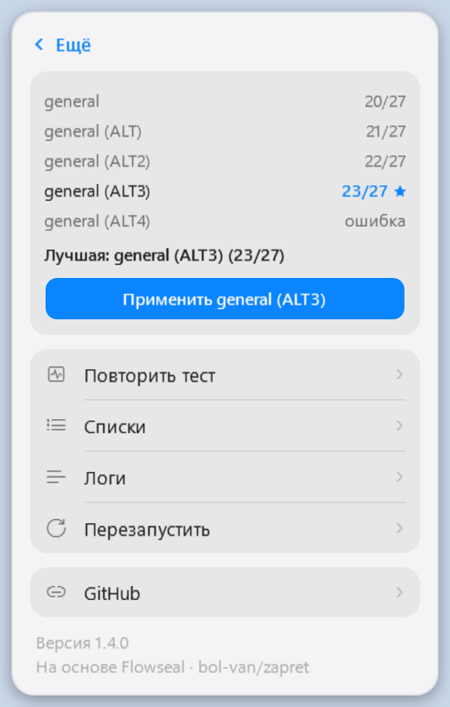
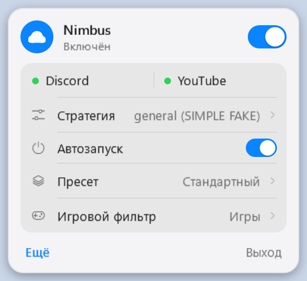
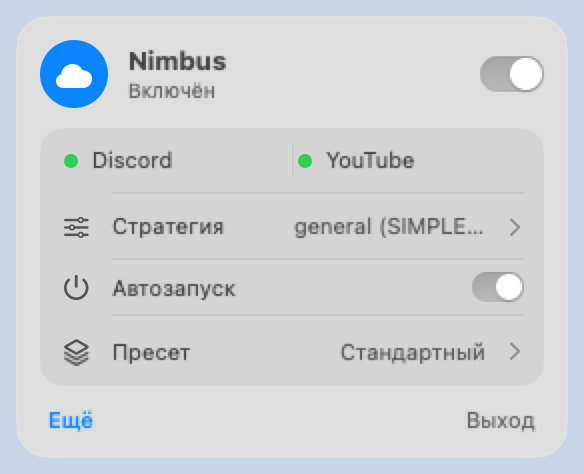

# Nimbus

Приложение для строки меню macOS и области уведомлений Windows, которое запускает zapret для обхода блокировок Discord и YouTube. Основано на [Flowseal/zapret-mac-discord-youtube](https://github.com/Flowseal/zapret-mac-discord-youtube), движок — [bol-van/zapret](https://github.com/bol-van/zapret).

<table>
  <tr>
    <th>Windows</th>
    <th>macOS</th>
  </tr>
  <tr>
    <td></td>
    <td></td>
  </tr>
  <tr>
    <td></td>
    <td></td>
  </tr>
</table>

<details>
<summary>Другие темы</summary>

| Windows | macOS |
| --- | --- |
|  |  |
|  |  |

</details>

Скриншоты отрендерены из настоящего интерфейса с примерными данными в CI (workflow `Screenshots` и `Build Windows x64`).

## Требования (macOS)

- macOS 14 или новее, Intel или Apple Silicon.
- Права администратора: при первом запуске устанавливается системный сервис.
- Cloudflare WARP должен быть выключен: он перехватывает все соединения. Обычные VPN (OpenVPN, WireGuard и подобные) можно не выключать.
- DNS не от провайдера, например `1.1.1.1` или `8.8.8.8`.

## Установка (macOS)

1. Скачайте `Nimbus-macOS-universal.zip` из [релизов](https://github.com/relocpe/Nimbus/releases).
2. Распакуйте архив и переместите `Nimbus.app` в папку «Программы».
3. Приложение подписано ad-hoc. При первом запуске откройте его через ПКМ → «Открыть» или снимите карантин:

   ```bash
   xattr -dr com.apple.quarantine /Applications/Nimbus.app
   ```

4. Нажмите на значок в строке меню, выберите стратегию и нажмите «Запустить». macOS запросит пароль администратора.

## Настройка

Стратегия выбирается в меню приложения. Быстрый путь: «Ещё» → «Найти и применить» — Nimbus пробует текущую и несколько проверенных стратегий и останавливается на первой, где открываются Discord и YouTube. Полный прогон всех стратегий по-прежнему доступен через «Тест стратегий».

Пользовательские списки добавляются в разделе «Списки»: можно вставить ссылку, домен или IP — Nimbus сам уберёт `https://` и путь и переведёт кириллицу в punycode. Там же можно обновить общие списки из Flowseal («Обновить списки»): ваши `*-user.txt` не трогаются. Вручную файлы лежат в `~/Library/Application Support/ZapretMac/lists/`:

| Файл | Назначение |
| --- | --- |
| `list-general-user.txt` | Дополнительные домены |
| `list-exclude-user.txt` | Исключённые домены |
| `ipset-all-user.txt` | Дополнительные IP-адреса |
| `ipset-exclude-user.txt` | Исключённые IP-адреса |

После изменения списков выберите стратегию заново (или просто добавьте запись в панели), чтобы сервис перезапустился.

«Ещё» → «Диагностика» проверяет `pf`, якорь Nimbus, `utun50`, маршрут и MAC шлюза, состояние IPv6 и активный VPN. Если VPN включён, в шапке появляется пометка «не трогаем»: Nimbus не вмешивается в его трафик. Для клиентов, которые перехватывают все соединения (WARP), показывается предупреждение. «Автопауза при VPN» по желанию ставит Nimbus на паузу, пока весь трафик идёт через VPN.

### VPN и свои исключения

Nimbus не трогает трафик VPN. Правила `pf` привязаны к физическому интерфейсу и пропускают без изменений туннели (`utun*`, `ipsec*`, `ppp*`, `tun*`, `tap*`, `wg*`), адреса серверов, к которым подключены VPN-клиенты, и адреса из поля «Ещё» → «Не трогать адреса» (IP или сеть через запятую, например `203.0.113.7, 10.8.0.0/16`). Список меняется на лету: движок не перезапускается, обновляется только якорь `pf`. Сервер VPN, у которого нет постоянного сокета (UDP без `connect`), Nimbus может не увидеть: тогда добавьте его адрес в это поле.

Автозапуск приложения включается в настройках.

## Windows

Версия для Windows лежит в тех же [релизах](https://github.com/relocpe/Nimbus/releases) и выглядит так же, как на Mac: значок облака в области уведомлений, та же панель со стратегиями, пресетами, игровым фильтром, умным подбором стратегии, списками, диагностикой, логами и обновлениями. Движок: `winws.exe` из [bol-van/zapret](https://github.com/bol-van/zapret) с драйвером WinDivert. «Игровой фильтр» есть только в Windows-версии.

### Требования

- Windows 10 или 11, 64-бит.
- Права администратора: WinDivert загружает сетевой драйвер.
- Cloudflare WARP, GoodbyeDPI и другие сборки zapret должны быть выключены. Обычные VPN можно не выключать.
- DNS не от провайдера, например `1.1.1.1` или `8.8.8.8`.

### Установка

1. Скачайте `Nimbus-Windows-x64.exe` из [релизов](https://github.com/relocpe/Nimbus/releases). Это один файл, установка не нужна: внутри уже есть .NET 8. Положите его в постоянную папку, например `C:\Program Files\Nimbus` или `C:\Users\<имя>\Apps`, и не удаляйте оттуда: на этот путь ссылаются автозапуск и обновления. Если .NET 8 Desktop Runtime уже установлен, можно взять более лёгкий `Nimbus-Windows-x64-lite.exe`.
2. Запустите файл и подтвердите запрос UAC. Если SmartScreen пишет «Система Windows защитила ваш компьютер», нажмите «Подробнее» → «Выполнить в любом случае»: файл не подписан сертификатом.
3. Откроется панель Nimbus. Выберите стратегию и включите переключатель. Потом панель открывается по клику на облако в области уведомлений; если значка не видно, он может быть спрятан под стрелкой `^`.

### Антивирус

Windows Defender и другие антивирусы часто помечают WinDivert (`WinDivert64.sys`) и `winws.exe` как `HackTool`/`RiskWare`. Это ложное срабатывание: драйвер перехватывает пакеты, поэтому его так классифицируют. Если файл удалён или заблокирован, добавьте в исключения антивируса `Nimbus-Windows-x64.exe` и папку `C:\ProgramData\Nimbus`. Скачивайте Nimbus только со страницы релизов этого репозитория.

### Как это работает на Windows

- При запуске движка Nimbus распаковывает `winws.exe`, WinDivert и файлы стратегий в `C:\ProgramData\Nimbus` и запускает `winws` в фоне. По умолчанию перехватываются те же порты, что и на Mac: TCP 80, 443, 2053, 2083, 2087, 2096, 8443 и UDP 443, 19294–19344, 50000–50100. «Игровой фильтр» расширяет этот набор (см. ниже).
- Стратегии, бинарные заготовки и списки общие с Mac-версией (`macos/Payload`).
- Настройки и списки хранятся в `%APPDATA%\Nimbus`; списки редактируются в разделе «Списки» или вручную в `%APPDATA%\Nimbus\lists`.
- Для стратегий с `fooling=ts` Nimbus включает TCP timestamps: `netsh interface tcp set global timestamps=enabled`.
- «Выход» закрывает панель, но движок продолжает работать, как сервис на Mac. Выключить движок можно переключателем.
- «Автозапуск» создаёт задачу планировщика `Nimbus` с наивысшими правами, поэтому при входе в систему UAC не спрашивает. Если движок был включён, Nimbus запустит его снова после перезагрузки или обновления.
- Обновления: Nimbus проверяет последний релиз `relocpe/Nimbus`, скачивает `Nimbus-Windows-x64.exe`, сверяет SHA-256 и заменяет себя.


### Игровой фильтр (только Windows)

В панели рядом с «Пресет» есть пункт «Игровой фильтр». Он работает поверх выбранной стратегии и нужен, когда Discord и YouTube открываются, а игра (Call of Duty, Steam, Battle.net) не подключается: игровой трафик идёт не на 443-й порт.

| Режим | Что делает |
| --- | --- |
| **Выкл** | Как раньше, только веб и голос Discord. Так и оставьте, если игры не трогаете. |
| **Игры** | Узкий набор портов под CoD, Steam и Battle.net: UDP `3074, 3075, 3478–3480, 3659, 4379–4380, 27000–27050` и TCP `3074, 3075, 1119, 3724`. |
| **Широкий** | Все порты `1024–65535` по TCP и UDP, как Game Filter в [Flowseal/zapret-discord-youtube](https://github.com/Flowseal/zapret-discord-youtube). Сильнее грузит систему и чаще задевает посторонние программы. |

Обход на этих портах идёт только по IP из текущего пресета (`--ipset`). Поэтому если включить «Игры» или «Широкий», когда пресет стоит на «Нет», Nimbus сам переключит пресет на «Стандартный» — иначе фильтр ничего не сделает. Режим пресета «Все» помогает, если адреса игры нет в списке, но его лучше не оставлять постоянно: могут отвалиться банки, Госуслуги и вырасти пинг. Свои адреса добавляйте в «Списки» или вручную в `ipset-all-user.txt` / `list-general-user.txt`, исключения — в `ipset-exclude-user.txt`.

- Cloudflare WARP должен быть выключен. Остальные VPN Nimbus не трогает: пока VPN-адаптер активен, движок привязывается к физическому интерфейсу и исключает адреса серверов VPN и адреса из поля «Не трогать адреса». При появлении или исчезновении VPN-адаптера движок перезапускается один раз.
- Античит Call of Duty (Ricochet) иногда не даёт игре запуститься, если загружен WinDivert, или может расценить подмену пакетов как постороннее ПО. Nimbus **не** скрывает драйвер. Если игра запускается без Nimbus и ломается с ним — выключите игровой фильтр или весь движок.

Если пропал интернет, выключите движок в Nimbus или завершите процесс `winws.exe` в диспетчере задач. Логи находятся в «Ещё» → «Логи» и в `C:\ProgramData\Nimbus\engine.log`.

## Как это работает (macOS)

Приложение устанавливает LaunchDaemon `io.github.flowseal.zapretmac` и файлы сервиса в `/Library/Application Support/ZapretMac`. Сервис запускает движок `utunws` на интерфейсе `utun50` и через правила `pf` (якорь `com.apple/zapret-macos`) направляет в него трафик на порты HTTP/HTTPS, Discord и QUIC. Если у системы есть IPv6-маршрут и MAC шлюза, Nimbus добавляет адрес `fd77::1` на `utun50` и такие же правила `inet6`; иначе остаётся только IPv4. Watchdog снимает правила `pf`, если движок останавливается или меняется сетевое подключение.

При обновлении с версии 1.4.0 и старше на macOS 27 (Tahoe) одно обновление нужно поставить вручную: из-за бага `lipo -verify_arch` встроенный установщик старой копии не принимает универсальный бинарник. Распакуйте `Nimbus-macOS-universal.zip` и перетащите `Nimbus.app` в «Программы». Следующие обновления из меню снова будут ставиться сами.

## Сборка

```bash
git clone https://github.com/relocpe/Nimbus.git
cd Nimbus
./macos/build.sh
```

Требуются `swiftc`, `clang` и `make`. Результат: `build/macos/Nimbus.app` и архив `dist/Nimbus-macOS-universal.zip`. Сборка подписывается ad-hoc.

Windows-версия (C#/.NET 8, WPF) собирается на Windows с установленным .NET 8 SDK:

```powershell
pwsh ./windows/build.ps1
```

Скрипт скачивает `winws.exe` и WinDivert из релиза zapret с проверкой SHA-256, прогоняет тесты и собирает два файла: `dist/Nimbus-Windows-x64.exe` (самодостаточный, .NET ставить не нужно) и `dist/Nimbus-Windows-x64-lite.exe` (маленький, нужен установленный .NET 8 Desktop Runtime). Тег `v*` запускает workflow `Release`, который собирает macOS и обе Windows-сборки и прикладывает их к релизу.

## Решение проблем

На Windows смотрите раздел [Windows](#windows) выше. Для macOS:

Логи доступны в меню «Ещё» → «Логи», основной файл — `engine.log`.

- **Сервис не запускается.** Проверьте `engine.log`. Чаще всего причина в Cloudflare WARP или другой сборке zapret.
- **Индикатор красный при запущенном сервисе.** Выберите другую стратегию и проверьте, что используется DNS не от провайдера.
- **После сбоя сервиса пропал интернет.** Остановите сервис вручную:

  ```bash
  sudo "/Library/Application Support/ZapretMac/stop.sh"
  ```

Если проблема не решена, создайте issue и приложите логи, удалив из них имя пользователя.

## Лицензия

MIT. Copyright bol-van, Flowseal, Nimbus. Подробности в [LICENSE](LICENSE).
