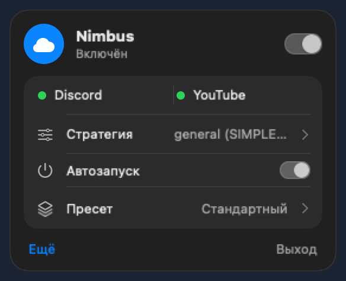
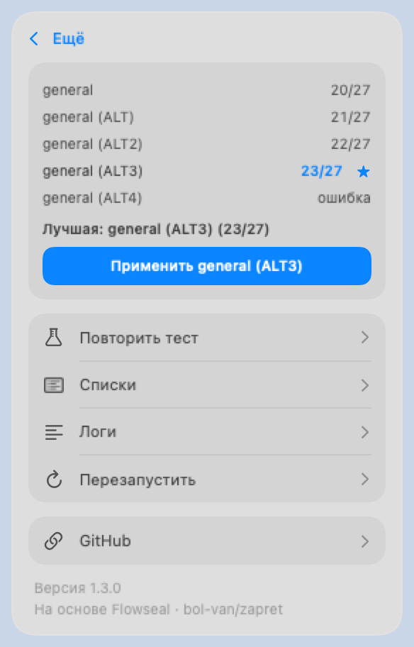

# Nimbus

Приложение для строки меню macOS и области уведомлений Windows, которое запускает zapret для обхода блокировок Discord и YouTube. Основано на [Flowseal/zapret-mac-discord-youtube](https://github.com/Flowseal/zapret-mac-discord-youtube), движок — [bol-van/zapret](https://github.com/bol-van/zapret).

<table>
  <tr>
    <th>Windows</th>
    <th>macOS</th>
  </tr>
  <tr>
    <td></td>
    <td></td>
  </tr>
  <tr>
    <td></td>
    <td></td>
  </tr>
</table>

<details>
<summary>Другие темы</summary>

| Windows | macOS |
| --- | --- |
|  |  |
|  |  |

</details>

Скриншоты отрендерены из настоящего интерфейса с примерными данными в CI (workflow `Screenshots` и `Build Windows x64`).

## Требования (macOS)

- macOS 14 или новее, Intel или Apple Silicon.
- Права администратора: при первом запуске устанавливается системный сервис.
- VPN должен быть выключен.
- DNS не от провайдера, например `1.1.1.1` или `8.8.8.8`.

## Установка (macOS)

1. Скачайте `Nimbus-macOS-universal.zip` из [релизов](https://github.com/relocpe/Nimbus/releases).
2. Распакуйте архив и переместите `Nimbus.app` в папку «Программы».
3. Приложение подписано ad-hoc. При первом запуске откройте его через ПКМ → «Открыть» или снимите карантин:

   ```bash
   xattr -dr com.apple.quarantine /Applications/Nimbus.app
   ```

4. Нажмите на значок в строке меню, выберите стратегию и нажмите «Запустить». macOS запросит пароль администратора.

## Настройка

Стратегия выбирается в меню приложения. Подобрать подходящую стратегию помогает «Ещё» → «Тест стратегий».

Пользовательские списки редактируются в разделе «Списки» приложения или вручную в `~/Library/Application Support/ZapretMac/lists/`:

| Файл | Назначение |
| --- | --- |
| `list-general-user.txt` | Дополнительные домены |
| `list-exclude-user.txt` | Исключённые домены |
| `ipset-exclude-user.txt` | Исключённые IP-адреса |

После изменения списков выберите стратегию заново, чтобы сервис перезапустился.

Автозапуск приложения включается в настройках.

## Windows

Версия для Windows лежит в тех же [релизах](https://github.com/relocpe/Nimbus/releases) и выглядит так же, как на Mac: значок облака в области уведомлений, та же панель со стратегиями, пресетами, тестом стратегий, списками, логами и обновлениями. Движок: `winws.exe` из [bol-van/zapret](https://github.com/bol-van/zapret) с драйвером WinDivert.

### Требования

- Windows 10 или 11, 64-бит.
- Права администратора: WinDivert загружает сетевой драйвер.
- VPN, GoodbyeDPI и другие сборки zapret должны быть выключены.
- DNS не от провайдера, например `1.1.1.1` или `8.8.8.8`.

### Установка

1. Скачайте `Nimbus-Windows-x64.exe` из [релизов](https://github.com/relocpe/Nimbus/releases). Это один файл, установка не нужна. Положите его в постоянную папку, например `C:\Program Files\Nimbus` или `C:\Users\<имя>\Apps`, и не удаляйте оттуда: на этот путь ссылаются автозапуск и обновления.
2. Запустите файл и подтвердите запрос UAC. Если SmartScreen пишет «Система Windows защитила ваш компьютер», нажмите «Подробнее» → «Выполнить в любом случае»: файл не подписан сертификатом.
3. Откроется панель Nimbus. Выберите стратегию и включите переключатель. Потом панель открывается по клику на облако в области уведомлений; если значка не видно, он может быть спрятан под стрелкой `^`.

### Антивирус

Windows Defender и другие антивирусы часто помечают WinDivert (`WinDivert64.sys`) и `winws.exe` как `HackTool`/`RiskWare`. Это ложное срабатывание: драйвер перехватывает пакеты, поэтому его так классифицируют. Если файл удалён или заблокирован, добавьте в исключения антивируса `Nimbus-Windows-x64.exe` и папку `C:\ProgramData\Nimbus`. Скачивайте Nimbus только со страницы релизов этого репозитория.

### Как это работает на Windows

- При запуске движка Nimbus распаковывает `winws.exe`, WinDivert и файлы стратегий в `C:\ProgramData\Nimbus` и запускает `winws` в фоне. Перехватываются те же порты, что и на Mac: TCP 80, 443, 2053, 2083, 2087, 2096, 8443 и UDP 443, 19294–19344, 50000–50100.
- Стратегии, бинарные заготовки и списки общие с Mac-версией (`macos/Payload`).
- Настройки и списки хранятся в `%APPDATA%\Nimbus`; списки редактируются в разделе «Списки» или вручную в `%APPDATA%\Nimbus\lists`.
- Для стратегий с `fooling=ts` Nimbus включает TCP timestamps: `netsh interface tcp set global timestamps=enabled`.
- «Выход» закрывает панель, но движок продолжает работать, как сервис на Mac. Выключить движок можно переключателем.
- «Автозапуск» создаёт задачу планировщика `Nimbus` с наивысшими правами, поэтому при входе в систему UAC не спрашивает. Если движок был включён, Nimbus запустит его снова после перезагрузки или обновления.
- Обновления: Nimbus проверяет последний релиз `relocpe/Nimbus`, скачивает `Nimbus-Windows-x64.exe`, сверяет SHA-256 и заменяет себя.

Если пропал интернет, выключите движок в Nimbus или завершите процесс `winws.exe` в диспетчере задач. Логи находятся в «Ещё» → «Логи» и в `C:\ProgramData\Nimbus\engine.log`.

## Как это работает (macOS)

Приложение устанавливает LaunchDaemon `io.github.flowseal.zapretmac` и файлы сервиса в `/Library/Application Support/ZapretMac`. Сервис запускает движок `utunws` на интерфейсе `utun50` и через правила `pf` (якорь `com.apple/zapret-macos`) направляет в него трафик на порты HTTP/HTTPS, Discord и QUIC. Watchdog снимает правила `pf`, если движок останавливается или меняется сетевое подключение.

## Сборка

```bash
git clone https://github.com/relocpe/Nimbus.git
cd Nimbus
./macos/build.sh
```

Требуются `swiftc`, `clang` и `make`. Результат: `build/macos/Nimbus.app` и архив `dist/Nimbus-macOS-universal.zip`. Сборка подписывается ad-hoc.

Windows-версия (C#/.NET 8, WPF) собирается на Windows с установленным .NET 8 SDK:

```powershell
pwsh ./windows/build.ps1
```

Скрипт скачивает `winws.exe` и WinDivert из релиза zapret с проверкой SHA-256, прогоняет тесты и собирает `dist/Nimbus-Windows-x64.exe`: один самодостаточный файл, .NET устанавливать не нужно. Тег `v*` запускает workflow `Release`, который собирает обе версии и прикладывает к релизу оба файла.

## Решение проблем

На Windows смотрите раздел [Windows](#windows) выше. Для macOS:

Логи доступны в меню «Ещё» → «Логи», основной файл — `engine.log`.

- **Сервис не запускается.** Проверьте `engine.log`. Чаще всего причина во включённом VPN.
- **Индикатор красный при запущенном сервисе.** Выберите другую стратегию и проверьте, что используется DNS не от провайдера.
- **После сбоя сервиса пропал интернет.** Остановите сервис вручную:

  ```bash
  sudo "/Library/Application Support/ZapretMac/stop.sh"
  ```

Если проблема не решена, создайте issue и приложите логи, удалив из них имя пользователя.

## Лицензия

MIT. Copyright bol-van, Flowseal, Nimbus. Подробности в [LICENSE](LICENSE).
